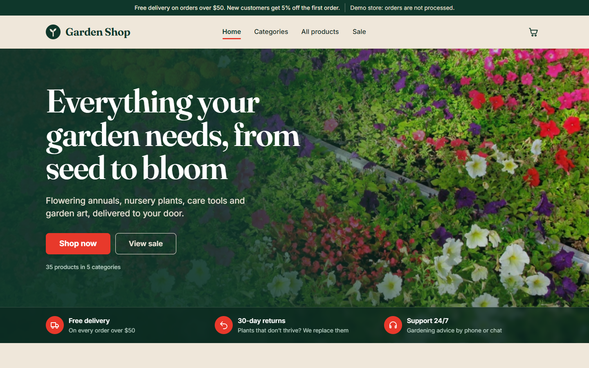
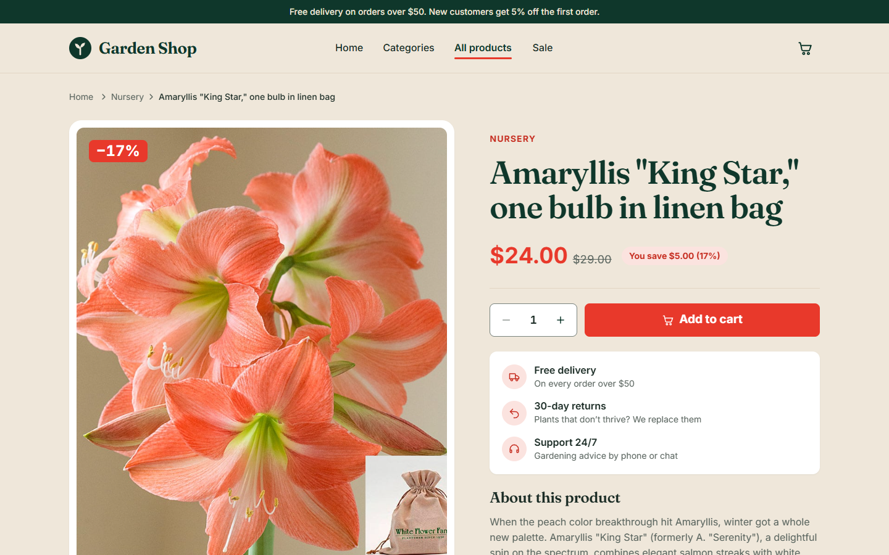
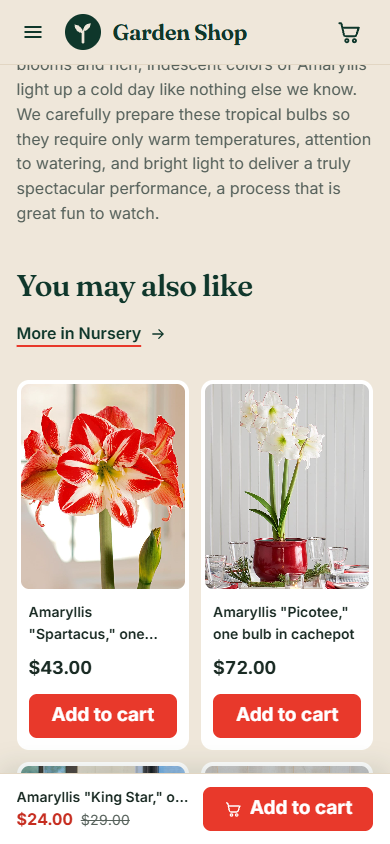
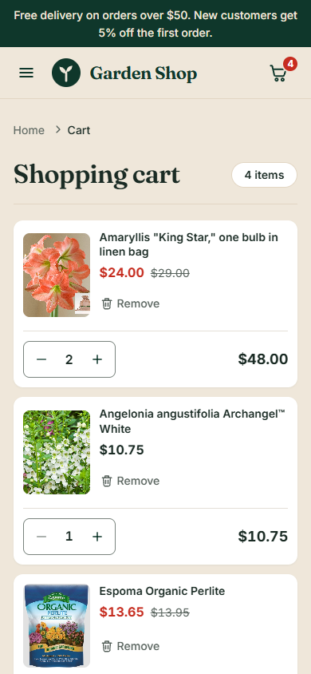
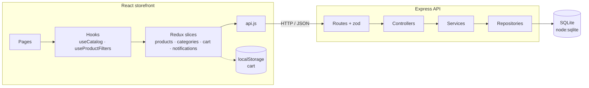

<div align="center">

# Garden Shop

**An online garden store: a React storefront and an Express API on SQLite. Catalog with filters, product pages, cart and checkout, plus a static demo on GitHub Pages.**

<a href="https://trusta01.github.io/react-express-garden-shop/"></a>

[](https://react.dev)
[](https://redux-toolkit.js.org)
[](https://vite.dev)
[](https://expressjs.com)
[](https://nodejs.org/api/sqlite.html)
[](#testing)
[](LICENSE)

Learning project · catalog data and photos are demo content

</div>

## Demo

**[trusta01.github.io/react-express-garden-shop](https://trusta01.github.io/react-express-garden-shop/)**

The demo has no server behind it: the catalog is served as static JSON (see [How the demo is built](#how-the-demo-is-built)). Everything works except sending: orders and coupon requests go nowhere, and the checkout window says so.

## Screenshots

| | |
|:---:|:---:|
|  |  |
| Home | Product page with a discount |

| | |
|:---:|:---:|
|  |  |
| Product on mobile: the buy bar stays at the bottom | Cart on mobile |

## What the store does

**Catalog.** Five categories, 35 products, a page with all products and a sale page. Every list can be filtered by price (two fields plus quick ranges: under $10, $10–25, $25–50, $50+) and by "on sale only", sorted by price or date, and paged 12 products at a time. On a phone the filters open in a bottom drawer with a counter of active filters on the button.

**Product page.** Photo, price with the old price crossed out and "You save $5.00 (17%)", quantity picker, delivery and returns notes, and four more products from the same category. On a phone a buy bar appears at the bottom once the main "Add to cart" button scrolls out of view.

**Cart.** Change quantities, remove items, see the total. The cart is kept in `localStorage`, so it survives a reload; if storage is full or disabled, the cart still works until the tab is closed. One product is capped at 999 pieces, the same limit the API accepts.

**Checkout.** Name, phone and e-mail, checked in the browser with React Hook Form and again on the server with zod. If the server rejects the data or cannot be reached, the form shows the reason; on success a confirmation window opens and the cart is cleared.

**Coupon form.** The home page offers 5% off the first order: leave a name, phone and e-mail, and the request goes to its own endpoint.

**States.** Loading, a load error with a retry button, an empty filter result, an unknown category or product, and a 404 page. Adding to the cart shows a toast.

**Design.** Fraunces for headings, Inter for text, a bottle-green, bone and vermilion palette. All colors, spacing and breakpoints live in one tokens file; contrast is checked against WCAG.

## Out of scope

- **Storing orders.** The API validates an order or a coupon request and answers `OK`, but does not save it. Saving or notifications plug into `orders.service.js`; the routes and the storefront do not change.
- **Payment, accounts, admin panel.** There are none: the store ends at the order form.
- **Search.** The catalog has filters and sorting, but no text search.

## Quick start

Requirements: Node.js **22.13+** (the backend uses the built-in `node:sqlite`).

```bash
npm run install:all   # installs the root, backend and frontend, creates and seeds the database
npm run dev           # API on http://localhost:3333, storefront on http://localhost:5173
```

The database file is created and filled from `backend/data/catalog.json` on the first start. `npm run seed` rebuilds it from scratch.

Settings are optional; defaults are in `backend/.env.example` and `frontend/.env.example`:

| Variable | App | Default | Purpose |
|---|---|---|---|
| `PORT` | backend | `3333` | API port |
| `DB_PATH` | backend | `data/garden-shop.sqlite` | SQLite file, relative to `backend/` |
| `CORS_ORIGIN` | backend | `*` | Allowed origins, comma-separated |
| `VITE_API_URL` | frontend | `http://localhost:3333` | API address |
| `VITE_BASE` | frontend | `/` | Path the app is served from |

Other root commands: `npm test`, `npm run lint`, `npm run build`, `npm run build:demo`.

## Architecture



The backend has three modules (`categories`, `products`, `orders`), each split into routes, controller, service and repository. `createApp()` builds the app without opening a port, so tests drive it directly.

### Key decisions

**The old API contract is kept byte for byte.** The backend was rewritten, but its JSON is identical to the original API, down to the misspelled `discont_price` field. Tests compare responses with saved responses of the old API, so a client written for the old server works with the new one unchanged. The one thing that was dropped on purpose is an old `GET` route that wrote to the database.

**Built-in `node:sqlite` instead of a driver package.** The catalog is small and read-only, so the database needs no server and no native module to compile: Node 22.13+ is enough. Queries are prepared once when the repository is created and take parameters, so values never get into SQL text. The schema checks prices at the database level: a price is not negative, and a discount price is not above the price.

**The catalog is loaded once.** It is tens of products, so the storefront requests `/products/all` and `/categories/all` once and builds category pages, the sale page, product pages and related products from that list. Filtering, sorting and paging run in the browser without extra requests.

**One error format.** Every error is `{ "error": { "code", "message" } }`: `VALIDATION_ERROR`, `INVALID_JSON`, `PAYLOAD_TOO_LARGE`, `NOT_FOUND`, `INTERNAL_ERROR`. The storefront shows `message` to the user as it is.

**Strict input.** IDs in paths are positive integers without signs or leading zeros; anything else is `400`. Request bodies are limited to 10 KB.

**Graceful shutdown.** On `SIGINT` or `SIGTERM` the server stops taking requests and closes the database.

## API

Base URL `http://localhost:3333`. Bodies are JSON.

| Method | Path | Purpose |
|---|---|---|
| GET | `/categories/all` | All categories |
| GET | `/categories/:id` | A category and its products |
| GET | `/products/all` | All products |
| GET | `/products/:id` | One product (in an array, as in the original API) |
| POST | `/order/send` | Order: name, phone, e-mail and items `[{ id, quantity }]` |
| POST | `/sale/send` | Coupon request: name, phone, e-mail |

Images are served from the same server: `/category_img/*`, `/product_img/*`.

Error example:

```json
{ "error": { "code": "VALIDATION_ERROR", "message": "Invalid request body: email must be an e-mail address" } }
```

## How the demo is built

GitHub Pages serves only static files, so `npm run build:demo`:

1. builds the storefront with `VITE_DEMO=true`, which makes it read JSON files instead of the API and simulate sending forms;
2. starts the real Express app on an in-memory database and saves each `GET` response to `dist/demo-api/`, so the demo shows exactly what the API returns;
3. copies the images into the build;
4. copies `index.html` to `404.html`, so a direct link like `/products/12` opens the right page.

On every push to `main` GitHub Actions runs the backend tests and the linter, builds the demo and deploys it.

## Testing

```bash
npm test
```

35 tests on `node:test` and supertest, run against a fresh in-memory database:

- catalog endpoints return exactly what the old API returned (saved responses in `backend/test/fixtures/legacy`);
- fractional prices and empty discounts survive the database round trip;
- wrong IDs give `400`, unknown ones `404`, both in the common error format;
- orders and coupon requests: valid bodies, a missing body, empty name, bad phone or e-mail, broken JSON, an oversized body, a non-positive quantity;
- images are served, a missing image gives a JSON `404`, CORS headers are present.

The storefront has no automated tests; it was checked by hand on desktop (1440 px) and mobile (390 px).

## Tech stack

| Area | Technologies |
|---|---|
| Storefront | React 19, Redux Toolkit, React Router 7, React Hook Form, CSS Modules with design tokens |
| Server | Node.js 22, Express 5, `node:sqlite`, zod, cors |
| Build and quality | Vite 8, ESLint 9, `node:test`, supertest, concurrently |
| Deploy | GitHub Actions, GitHub Pages |

## Project structure

```
.
├── frontend/
│   ├── src/
│   │   ├── pages/               # one folder per page
│   │   ├── components/          # cards, filters, pagination, modal, header, footer
│   │   ├── hooks/               # useCatalog, useProductFilters, usePageTitle
│   │   ├── store/slices/        # products, categories, cart, notifications
│   │   ├── config/api.js        # API address, demo mode
│   │   └── styles/              # tokens.css, global.css
│   └── scripts/build-demo.mjs   # static build for GitHub Pages
├── backend/
│   ├── src/
│   │   ├── modules/             # categories, products, orders
│   │   ├── middleware/          # validation, errors
│   │   ├── db/                  # schema, connection, seeding
│   │   └── config/              # settings from the environment
│   ├── data/catalog.json        # catalog the database is seeded from
│   ├── public/                  # product and category images
│   └── test/
├── docs/screenshots/
└── .github/workflows/           # tests, lint, demo build, deploy
```

## License

Code: [MIT](LICENSE). The catalog data and photos are demo content and are not covered by the license.
