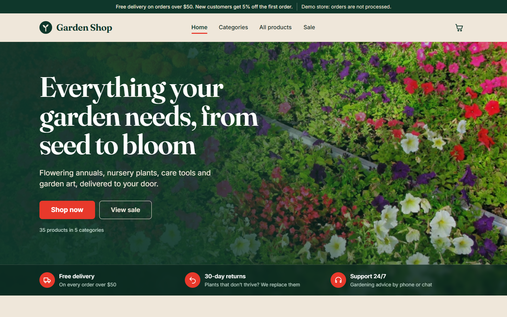
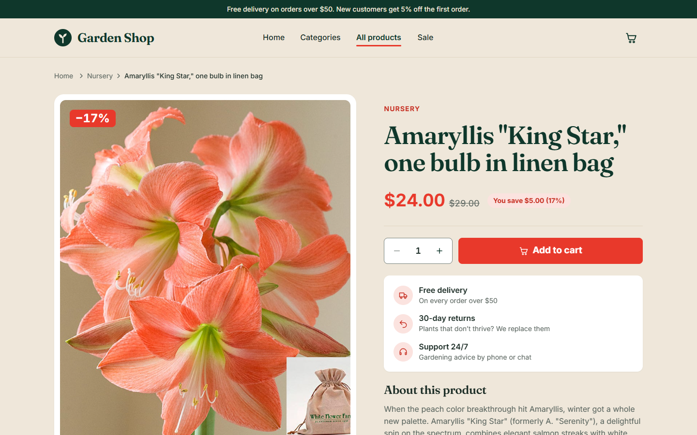
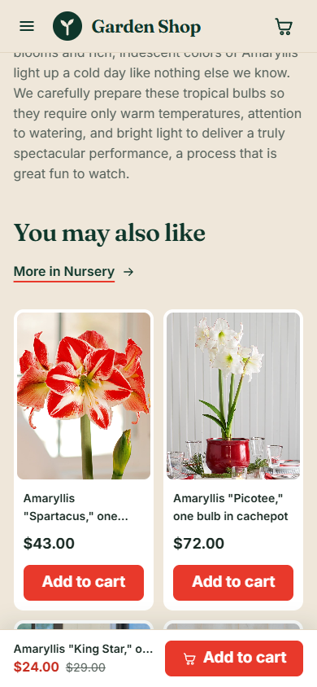
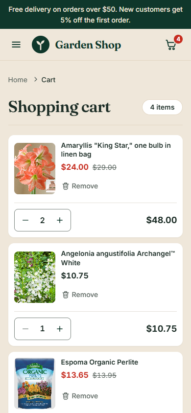
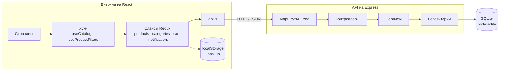

<div align="center">

# Garden Shop

**Интернет-магазин товаров для сада: витрина на React и API на Express и SQLite. Каталог с фильтрами, страницы товаров, корзина и оформление заказа, плюс статическое демо на GitHub Pages.**

[](https://react.dev)
[](https://redux-toolkit.js.org)
[](https://vite.dev)
[](https://expressjs.com)
[](https://nodejs.org/api/sqlite.html)
[](#тесты)
[](LICENSE)

Учебный проект · данные каталога и фотографии демонстрационные

[English](README.md) · **Русский**

</div>

## Демо

<a href="https://trusta01.github.io/react-express-garden-shop/"></a>

## Скриншоты

| | |
|:---:|:---:|
|  |  |
| Главная | Товар со скидкой |

| | |
|:---:|:---:|
|  |  |
| Товар на телефоне: панель покупки прижата к низу | Корзина на телефоне |

## Что умеет магазин

**Каталог.** Пять категорий, 35 товаров, страница со всеми товарами и страница распродажи. Любой список можно отфильтровать по цене (два поля и готовые диапазоны: до $10, $10–25, $25–50, от $50) и по признаку «только со скидкой», отсортировать по цене или дате и листать по 12 товаров. На телефоне фильтры открываются в шторке снизу, а на кнопке видно, сколько фильтров включено.

**Страница товара.** Фото, цена с зачёркнутой старой и плашкой «You save $5.00 (17%)», выбор количества, условия доставки и возврата и ещё четыре товара из той же категории. На телефоне, когда основная кнопка «Add to cart» уходит за край экрана, снизу появляется панель покупки.

**Корзина.** Можно менять количество, удалять товары и видеть итог. Корзина хранится в `localStorage` и переживает перезагрузку страницы. Если хранилище переполнено или отключено, корзина всё равно работает до закрытия вкладки. Одного товара можно положить не больше 999 штук: столько же принимает API.

**Оформление заказа.** Имя, телефон и e-mail проверяются в браузере через React Hook Form и ещё раз на сервере через zod. Если сервер отклонил данные или не ответил, форма показывает причину. После успешной отправки открывается окно подтверждения, а корзина очищается.

**Купон.** На главной предлагается скидка 5% на первый заказ: человек оставляет имя, телефон и e-mail, заявка уходит на отдельный эндпоинт.

**Состояния.** Загрузка, ошибка загрузки с кнопкой повтора, пустой результат фильтров, несуществующая категория или товар, страница 404. При добавлении в корзину появляется уведомление.

**Дизайн.** Заголовки набраны Fraunces, текст Inter, палитра из бутылочно-зелёного, цвета слоновой кости и киновари. Все цвета, отступы и брейкпоинты собраны в одном файле токенов, контраст проверен по WCAG.

## Чего здесь нет

- **Хранения заказов.** API проверяет заказ или заявку на купон и отвечает `OK`, но никуда их не сохраняет. Сохранение или уведомления подключаются в `orders.service.js`, маршруты и витрина при этом не меняются.
- **Оплаты, личного кабинета, админки.** Магазин заканчивается формой заказа.
- **Поиска.** В каталоге есть фильтры и сортировка, но нет поиска по тексту.

## Быстрый старт

Нужен Node.js **22.13+**: бэкенд использует встроенный `node:sqlite`.

```bash
npm run install:all   # ставит зависимости корня, бэкенда и фронтенда, создаёт и заполняет базу
npm run dev           # API на http://localhost:3333, витрина на http://localhost:5173
```

При первом запуске файл базы создаётся и заполняется из `backend/data/catalog.json`. `npm run seed` пересоздаёт его с нуля.

Настраивать ничего не обязательно, значения по умолчанию лежат в `backend/.env.example` и `frontend/.env.example`:

| Переменная | Приложение | По умолчанию | Назначение |
|---|---|---|---|
| `PORT` | backend | `3333` | Порт API |
| `DB_PATH` | backend | `data/garden-shop.sqlite` | Файл SQLite относительно `backend/` |
| `CORS_ORIGIN` | backend | `*` | Разрешённые источники через запятую |
| `VITE_API_URL` | frontend | `http://localhost:3333` | Адрес API |
| `VITE_BASE` | frontend | `/` | Путь, по которому открывается приложение |

Остальные команды из корня: `npm test`, `npm run lint`, `npm run build`, `npm run build:demo`.

## Архитектура



В бэкенде три модуля (`categories`, `products`, `orders`), и каждый разделён на маршруты, контроллер, сервис и репозиторий. `createApp()` собирает приложение, не открывая порт, поэтому тесты работают с ним напрямую.

### Ключевые решения

**Контракт старого API сохранён байт в байт.** Бэкенд переписан, но отдаёт тот же JSON, что и исходный API, вплоть до поля с опечаткой `discont_price`. Тесты сравнивают ответы с сохранёнными ответами старого API, поэтому клиент, написанный под старый сервер, работает с новым без изменений. Намеренно убрано только одно: старый `GET`-маршрут, который писал в базу.

**Встроенный `node:sqlite` вместо пакета-драйвера.** Каталог маленький и только читается, поэтому базе не нужен ни отдельный сервер, ни нативный модуль, который пришлось бы компилировать: хватает Node 22.13+. Запросы готовятся один раз при создании репозитория и принимают параметры, так что значения никогда не попадают в текст SQL. Цены проверяет сама схема: цена не бывает отрицательной, а цена со скидкой не бывает выше обычной.

**Каталог загружается один раз.** В нём несколько десятков товаров, поэтому витрина один раз запрашивает `/products/all` и `/categories/all` и строит из этого списка страницы категорий, распродажу, страницы товаров и похожие товары. Фильтры, сортировка и пагинация работают в браузере без лишних запросов.

**Единый формат ошибок.** Любая ошибка выглядит как `{ "error": { "code", "message" } }`: `VALIDATION_ERROR`, `INVALID_JSON`, `PAYLOAD_TOO_LARGE`, `NOT_FOUND`, `INTERNAL_ERROR`. Витрина показывает `message` пользователю как есть.

**Строгая проверка входа.** ID в пути — положительное целое без знака и ведущих нулей, всё остальное получает `400`. Тело запроса ограничено 10 КБ.

**Корректная остановка.** По `SIGINT` или `SIGTERM` сервер перестаёт принимать запросы и закрывает базу.

## API

Базовый адрес `http://localhost:3333`, тела запросов в JSON.

| Метод | Путь | Назначение |
|---|---|---|
| GET | `/categories/all` | Все категории |
| GET | `/categories/:id` | Категория и её товары |
| GET | `/products/all` | Все товары |
| GET | `/products/:id` | Один товар (в массиве, как в исходном API) |
| POST | `/order/send` | Заказ: имя, телефон, e-mail и позиции `[{ id, quantity }]` |
| POST | `/sale/send` | Заявка на купон: имя, телефон, e-mail |

Картинки отдаёт тот же сервер: `/category_img/*`, `/product_img/*`.

Пример ошибки:

```json
{ "error": { "code": "VALIDATION_ERROR", "message": "Invalid request body: email must be an e-mail address" } }
```

## Как собирается демо

GitHub Pages отдаёт только статические файлы, поэтому `npm run build:demo`:

1. собирает витрину с `VITE_DEMO=true`: в этом режиме она читает JSON-файлы вместо API и только имитирует отправку форм;
2. запускает настоящее приложение Express на базе в памяти и сохраняет ответ каждого `GET` в `dist/demo-api/`, так что демо показывает ровно то, что вернул бы API;
3. копирует картинки в сборку;
4. копирует `index.html` в `404.html`, чтобы прямая ссылка вроде `/products/12` открывала нужную страницу.

При каждом пуше в `main` GitHub Actions прогоняет тесты бэкенда и линтер, собирает демо и выкладывает его.

## Тесты

```bash
npm test
```

35 тестов на `node:test` и supertest, каждый прогон идёт на свежей базе в памяти:

- эндпоинты каталога отдают ровно то же, что старый API (сохранённые ответы лежат в `backend/test/fixtures/legacy`);
- дробные цены и пустые скидки не искажаются при записи в базу и чтении;
- неверный ID даёт `400`, несуществующий — `404`, оба в общем формате ошибок;
- заказы и заявки на купон: корректное тело, пустое тело, пустое имя, неверный телефон или e-mail, сломанный JSON, слишком большое тело, неположительное количество;
- картинки отдаются, на отсутствующую картинку приходит `404` в JSON, заголовки CORS на месте.

Автотестов у витрины нет, её проверяли вручную на десктопе (1440 px) и телефоне (390 px).

## Стек

| Область | Технологии |
|---|---|
| Витрина | React 19, Redux Toolkit, React Router 7, React Hook Form, CSS Modules с дизайн-токенами |
| Сервер | Node.js 22, Express 5, `node:sqlite`, zod, cors |
| Сборка и качество | Vite 8, ESLint 9, `node:test`, supertest, concurrently |
| Деплой | GitHub Actions, GitHub Pages |

## Структура проекта

```
.
├── frontend/
│   ├── src/
│   │   ├── pages/               # по папке на страницу
│   │   ├── components/          # карточки, фильтры, пагинация, модалка, шапка, подвал
│   │   ├── hooks/               # useCatalog, useProductFilters, usePageTitle
│   │   ├── store/slices/        # products, categories, cart, notifications
│   │   ├── config/api.js        # адрес API, демо-режим
│   │   └── styles/              # tokens.css, global.css
│   └── scripts/build-demo.mjs   # статическая сборка для GitHub Pages
├── backend/
│   ├── src/
│   │   ├── modules/             # categories, products, orders
│   │   ├── middleware/          # валидация, ошибки
│   │   ├── db/                  # схема, подключение, заполнение
│   │   └── config/              # настройки из окружения
│   ├── data/catalog.json        # каталог, из которого заполняется база
│   ├── public/                  # картинки товаров и категорий
│   └── test/
├── docs/screenshots/
└── .github/workflows/           # тесты, линтер, сборка демо, деплой
```

## Лицензия

Код распространяется по [MIT](LICENSE). Данные каталога и фотографии демонстрационные, лицензия на них не распространяется.
